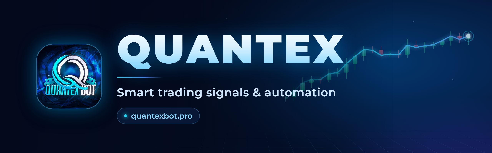

<div align="center">



<br/>

[](https://t.me/QuantexBinaryTools_bot)
[](https://quantexbot.pro)
[](https://quantexbot.pro/docs/api)


[](https://quantexbot.pro/status)


**Binary options signals, auto trading, your own signal bot and live market data — in one platform.**

[**Get started**](docs/getting-started.md) ·
[**User guide**](docs/user-guide.md) ·
[**Auto Trading**](docs/guide/14-auto-trading.md) ·
[**Q-BOT STUDIO**](docs/studio.md) ·
[**Developer API**](api/README.md) ·
[**Pricing**](docs/pricing.md) ·
[**Changelog**](CHANGELOG.md)

</div>

---

## Overview

**QUANTEX** is a trading-signal platform for **QUOTEX**, **TRADOWIX** and **BINOLLA**, covering 300+ OTC and Live markets. Everything starts in the Telegram bot [@QuantexBinaryTools_bot](https://t.me/QuantexBinaryTools_bot). Around it there are a website, a Developer API and a no-code bot builder.

| | Product | What it does |
|:-:|---|---|
| 📡 | **[Telegram signal bot](docs/user-guide.md)** | Live Session, Live Signal, Future Signals, checkers, news signals, tools and a live chart, all inside Telegram |
| 🤖 | **[Auto Trading](docs/guide/14-auto-trading.md)** | Trades the signals on **your own broker account**, with money-management plans, stop loss and take profit |
| 🧩 | **[Q-BOT STUDIO](docs/studio.md)** | Build and deploy **your own branded signal bot** in 9 guided steps, with no coding |
| 🌐 | **[Website](docs/website.md)** | Accounts, Live Signal and Future Signal on the web, Live Chart, billing, AI support and status, in 3 languages |
| 🔌 | **[Developer API](api/README.md)** | Brokers, pairs, payouts, OHLC candles, historical candles and **live ticks** for your own apps |

> [!NOTE]
> **New in v5.4:**
> - **Auto Trading:** money-management plans and the **QX Auto TF** strategy.
> - **Studio:** **AXTIRON FS** in Q-BOT STUDIO PRO / ELITE.
> - **Website:** Telegram bot packages can be bought on the website again.
> - **API:** **BINOLLA live ticks** in the Developer API.
>
> See the [changelog](CHANGELOG.md).

---

## Highlights

<table>
<tr>
<td width="50%" valign="top">

### 📡 Signals
- **Strategy Mode**: 7 analyzers, from QUANTUM SCAN to HYBRID ENGINE V3
- **Scanning Mode**: a shared supply/demand zone and trendline scanner
- AI-confirmed **Live Signal** with chart, payout and S/R levels
- **Live Session** and **Schedule Session** to your channel (M1–M15)
- **Future Signals**: OTC, Live, Blackout, Whiteout, Future Live, **AXTIRON FS**
- **News Signal** from the economic calendar

</td>
<td width="50%" valign="top">

### 🤖 Auto Trading
- Secure broker sign-in: the **password is never stored**
- **Signal Config**: the bot finds the signals for you
- **QX Auto TF**: picks the best market and timeframe (M1–M5)
- **Normal plan**, **Masaniello sheet**, **Smart Money Management**
- Stop loss / take profit auto stop, safety margin, account safety
- Live dashboard, terminal log, history with broker order IDs

</td>
</tr>
<tr>
<td valign="top">

### ✅ Checkers & tools
- Live, OTC, Blackout, Whiteout and custom-date **checkers**
- **AI Filter** for any future-signal list (1–30 days of history)
- Formatter, TZ Converter, Market Filters, **Live Payouts**
- **Live Chart** for every market, with indicators and drawing tools

</td>
<td valign="top">

### 🧩 Platform
- **Q-BOT STUDIO**: FREE · LITE · PRO · ELITE
- **Website** in English, বাংলা and Português
- **Developer API**: REST + Server-Sent Events, OpenAPI 3.1
- **Auto Payment**: Binance Pay, USDT TRC20 / BEP20
- 24/7 self-healing runtime on PostgreSQL

</td>
</tr>
</table>

---

## Signal engines

Live Session, Schedule Session, Auto Signal and Group Live Signal all start with the choice of an engine. The admin decides which analyzers are available.

| Analyzer | Style |
|---|---|
| ⚛️ **QUANTUM SCAN** | Dynamic MTF and market structure; trend continuation only, a steady flow of signals |
| ✨ **SMART FOCUS** | Quality first: one market at a time, defended levels, tick-pressure confirmation |
| 🚀 **HYBRID ENGINE** | MTF, structure and trap detection; continuation and confirmed reversals, score 75+ |
| ⚙️ **HYBRID ENGINE V2 ASTRA** | RSI strategy and RSI level flow, tuned per broker and market, with Heikin Ashi confirmation |
| ⚡ **QUANTEX TURBO** | MACD cross with the EMA 50 trend, closed candles only |
| 🚀 **HYBRID ENGINE V3** | 96 strategy candidates per market; the best one is applied automatically and re-optimised when it weakens |
| 🚀 **WT POWER** | EMA 7 / 21 with support and resistance zones: reversals at the zone |
| 📡 **SCANNING MODE** | One shared scanner for supply/demand zones and trendlines across every open market |

Every analyzer uses **closed candles only**, rejects bad candles (dojis, wickless and oversized candles), cools a market down after a signal and can skip low-payout markets. → [Strategies in detail](docs/guide/05-strategies.md)

---

## Auto Trading

<table>
<tr><td>

**1 · Connect.** Open **AUTO TRADING** in the bot, choose QUOTEX, TRADOWIX or BINOLLA and sign in. Only an encrypted session is kept.

**2 · Choose your signals.** Use Live Signal, Live Session, your own future lists, or let **Signal Config** run the signals for you (including **QX Auto TF**).

**3 · Set your plan.** Set a trade amount, martingale, stop loss and take profit, or start a money-management plan:

| Plan | How it works |
|---|---|
| **Normal plan** | $100 split into 5 cycles of $20; each cycle aims for about +$5, with no martingale |
| **Masaniello sheet** | Your capital, number of trades, expected wins and odds give an exact stake table |
| **Smart Money Management** | The Masaniello sheet without martingale, with an optional safety margin |

**4 · Watch.** Follow the dashboard, the live log and the history. When a limit or plan ends, you get a summary card and a Telegram message.

</td></tr>
</table>

Auto Trading is included in the **PLUS** and **INFINITY** packages. → [Full Auto Trading guide](docs/guide/14-auto-trading.md)

> [!WARNING]
> Trading involves risk. Auto Trading follows your settings; it does not guarantee profit. Start on a **demo** account.

---

## Brokers & markets

| Broker | Markets | Live feed | Live ticks (chart & API) | Auto Trading |
|---|---|:-:|:-:|:-:|
| **QUOTEX** | OTC + Live currencies, crypto, commodities, stocks, indices | ✅ | ✅ | ✅ |
| **TRADOWIX** | OTC + Live | ✅ | ✅ | ✅ |
| **BINOLLA** | OTC + Live, including international stocks (e.g. `0700.HK_otc`) | ✅ | ✅ | ✅ |

Set a **Primary Broker** once and every feature uses it. → [Full market list](docs/supported-markets.md)

---

## Pricing

| Telegram bot | Price | Future signals / day | Live signals / day | Extras |
|---|---|:-:|:-:|---|
| **FREE** | $0 | 2 | 5 | Checkers, tools, Live Chart |
| **STARTER** | $18 / month | 3 | 25 | More daily signals |
| **PLUS** ⭐ | $32 / month | 10 | 60 | Web Control, template editing, **Auto Trading** |
| **INFINITY** | $49 / month | Unlimited | Unlimited | **Auto Trading** and 1 Q-BOT STUDIO bot |

| Q-BOT STUDIO | Monthly | Yearly | Bots | Brokers | Features |
|---|---|---|:-:|---|:-:|
| **LITE** | $30 | $300 | 1 | QUOTEX | 14 |
| **PRO** ⭐ | $55 | $550 | 3 | any 2 | 20 |
| **ELITE** | $80 | $800 | 5 | all 3 | 23 |

| Website & API | Price |
|---|---|
| **Website Signal package**: unlimited Live and Future signals on the website and app | $25 / 30 days |
| **Developer API**: Developer (free) · Candle Basic · Candle Data API · Full Market Data API | Free · $15 · $30 · $50 / month |

You can pay with **Binance Pay** or **USDT (TRC20 / BEP20)**. Payments are verified automatically and activate at once. → [Pricing details](docs/pricing.md) · [quantexbot.pro/pricing](https://quantexbot.pro/pricing)

---

## Get started

1. **Join** the main channel [t.me/bdtraderpro](https://t.me/bdtraderpro). The bot requires it.
2. **Open** [@QuantexBinaryTools_bot](https://t.me/QuantexBinaryTools_bot) and tap **Start**.
3. **Choose** your Primary Broker in **Settings**.
4. **Try** a free Live Signal, then upgrade in the bot or on [quantexbot.pro/pricing](https://quantexbot.pro/pricing).

→ [Getting started guide](docs/getting-started.md) · [Complete user guide](docs/user-guide.md)

---

## Developer API

Market data from the QUANTEX feed, as JSON over HTTPS with a Server-Sent Events stream for live ticks.

```bash
# Create a free account at https://quantexbot.pro/register, then a key in Dashboard → API keys
KEY="qx_live_YOUR_KEY"

# Open OTC pairs of QUOTEX
curl "https://api.quantexbot.pro/v1/pairs?broker=quotex&market=otc&open=true" -H "Authorization: Bearer $KEY"

# The latest 100 M1 candles
curl "https://api.quantexbot.pro/v1/candles?broker=quotex&pair=EURUSD_otc&tf=M1&limit=100" -H "Authorization: Bearer $KEY"

# Live ticks: QUOTEX, TRADOWIX and BINOLLA (Full Market Data API)
curl -N "https://api.quantexbot.pro/v1/stream/ticks?broker=binolla&pairs=EURUSD_otc,0700.HK_otc" -H "Authorization: Bearer $KEY"
```

[API reference](api/README.md) · [OpenAPI 3.1](api/openapi.json) · [Code examples](examples/README.md) · [llms.txt](llms.txt)

---

## Documentation

| Start here | Telegram bot | Platform |
|---|---|---|
| [Getting started](docs/getting-started.md) | [User guide (14 chapters)](docs/user-guide.md) | [Website](docs/website.md) |
| [Features](docs/features.md) | [Strategies](docs/guide/05-strategies.md) | [Developer API](api/README.md) |
| [Pricing](docs/pricing.md) | [Signal guide](docs/signal-guide.md) | [Architecture](docs/architecture.md) |
| [FAQ](docs/faq.md) | [Auto Trading](docs/guide/14-auto-trading.md) | [Code examples](examples/README.md) |
| [Changelog](CHANGELOG.md) | [Q-BOT STUDIO](docs/studio.md) | [Roadmap](docs/roadmap.md) |

All pages: [docs/README.md](docs/README.md)

<details>
<summary><b>Repository layout</b></summary>

```text
QUANTEX-BOT-REPO/
├── README.md              you are here
├── CHANGELOG.md           every release, newest first
├── llms.txt               index for AI assistants
├── assets/                images used by the docs
├── docs/
│   ├── README.md          documentation index
│   ├── getting-started.md
│   ├── user-guide.md      → guide/01 … guide/14
│   ├── guide/             step-by-step chapters (main menu → auto trading)
│   ├── features.md · signal-guide.md · supported-markets.md
│   ├── studio.md · pricing.md · website.md
│   └── architecture.md · faq.md · roadmap.md
├── api/
│   ├── README.md          Developer API reference
│   └── openapi.json       OpenAPI 3.1
└── examples/              Python · Node.js · PHP · cURL
```

</details>

---

## Support & community

| | |
|---|---|
| 🤖 Telegram bot | [@QuantexBinaryTools_bot](https://t.me/QuantexBinaryTools_bot) |
| 📢 Main channel (required) | [t.me/bdtraderpro](https://t.me/bdtraderpro) |
| 📢 Channel | [@Quantexbot1](https://t.me/Quantexbot1) |
| 👥 Community | [t.me/quantexlounge](https://t.me/quantexlounge) |
| 👤 Owner & support | [@X_Akash_Owner](https://t.me/X_Akash_Owner) · [quantexbotsupport@gmail.com](mailto:quantexbotsupport@gmail.com) |
| 🌐 Website | [quantexbot.pro](https://quantexbot.pro) · [Contact form](https://quantexbot.pro/contact) · [System status](https://quantexbot.pro/status) |

---

> [!CAUTION]
> Binary options trading carries a high level of risk. Signals and automated trades are analysis, not a guarantee of profit. Trade only with money you can afford to lose.

<div align="center">
<sub>© 2026 QUANTEX · Commercial software · This repository contains public documentation only.</sub>
</div>
